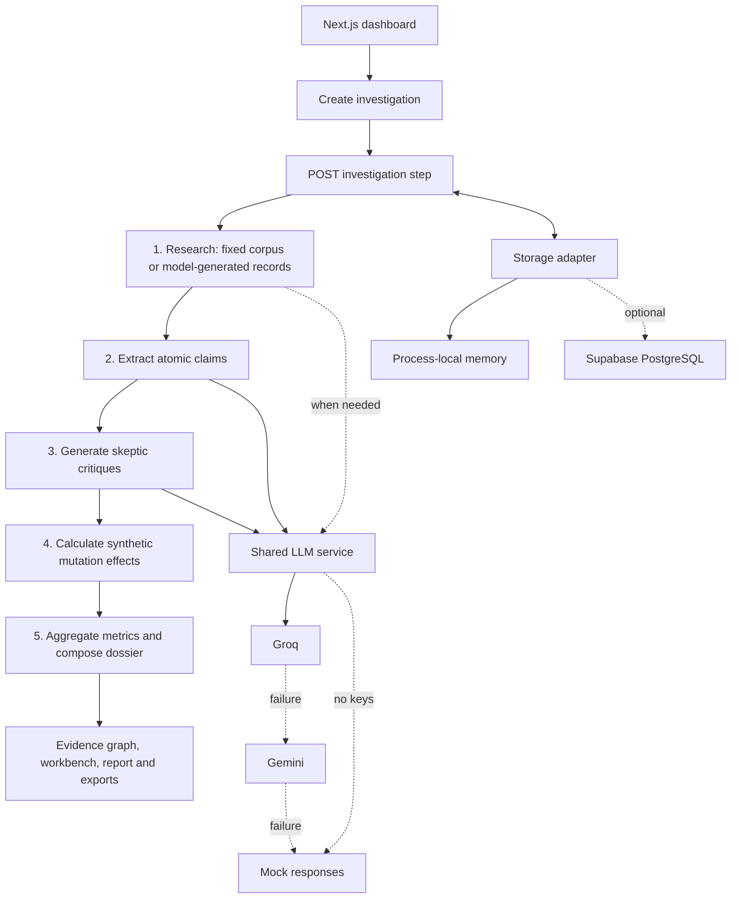

# ProofForge AI

**Explore how research conclusions change when their supporting evidence is challenged.**

ProofForge AI is a research verification **prototype** that turns a scientific question into an interactive graph of claims, evidence records, skeptic critiques, and synthetic stress tests. Its central idea is evidence mutation testing: make a conclusion's dependence on its evidence visible through simulated ablation, contradiction, and parameter changes.

The application combines a Next.js dashboard, a five-stage TypeScript workflow, optional Groq/Gemini inference, and optional Supabase storage. It includes a demonstration mode that requires no model credentials.

[Repository](https://github.com/subhranshu25scs1003001500-stack/PrrofForge-AI) · [Quick start](#quick-start) · [Project comparison](#comparison-with-related-open-source-projects) · [Limitations](#current-limitations)

> **Status:** An inspectable demonstration of a verification workflow, with optional live model calls. The current implementation does not independently validate citations, retrieve live literature, or establish that a scientific claim is true. Demonstration records and generated scores need independent review.

## What you can do

- **Inspect a claim graph.** Explore hypothesis, claim, evidence, skeptic, and mutation nodes in a React Flow canvas, with detail drawers.
- **Follow the investigation.** Run the five stages individually or use the browser's automatic progression, with stage logs and timings.
- **Review skeptic critiques.** Inspect generated challenges concerning selection bias, confounding, sample size, and other methodological issues.
- **Explore synthetic mutations.** Compare confidence before and after simulated evidence removal, contradiction, and baseline substitution.
- **Read an investigation dossier.** View claim statuses, aggregate stability metrics, and a template-generated report.
- **Export results.** Download Markdown or JSON, copy the report, or use browser printing and Save as PDF. There is no dedicated PDF generation service.
- **Try the interface without credentials.** Seeded investigations, fixed corpora, and mock responses demonstrate the workflow locally.

These capabilities are implemented in the [dashboard][dashboard], [agent modules][agents], and [export endpoint][export-source].

## How it works



The diagram summarizes the workflow; each step request executes **one** stage, saves the investigation, and returns its updated state. Later requests advance it through `CREATED`, `RESEARCHING`, `EXTRACTING_CLAIMS`, `SKEPTIC_AUDIT`, `MUTATION_TESTING`, and `COMPLETED`. Synthesis occurs within the final step. This is a request-driven state machine, with browser-controlled automatic progression, rather than a background job system. See the [orchestrator][orchestrator-source].

### Where evidence comes from

The [research agent][research-source] first checks keyword-matched, hard-coded scientific corpora. For other questions, it asks a model to return structured citation records; if that fails, it returns generic demonstration records. No search engine, paper downloader, DOI resolver, or citation validation API is called by this module.

Adding an API key enables model-generated responses; it does **not** add retrieval grounding. Some fallback records are marked `isSynthetic: false` and `isPeerReviewed: true` in code despite being demonstration content. Treat those fields as application metadata, not certification of a source's existence or quality. The initial seeded dossier is also demonstration content.

### What mutation scores mean

The [mutation engine][mutation-source] creates three synthetic experiments for each claim with available evidence. It selects the first associated evidence record, or the first evidence record overall, and applies fixed penalties to post-skeptic confidence:

| Mutation | Simulated question | Implemented confidence penalty |
| --- | --- | --- |
| Ablation | What if the primary citation were unavailable? | Evidence strength × `0.42` |
| Contradiction | What if a conflicting result were introduced? | Evidence strength × `0.55` |
| Parameter swap | What if the baseline conditions changed? | Evidence strength × `0.25` |

The implementation applies confidence floors, considers a mutation survived at confidence ≥ `0.55`, and derives each claim's stability from average relative sensitivity. The dossier's **Conclusion Stability Index (CSI)** is the rounded mean of claim stability scores. Mutation resilience is the percentage of experiments marked as survived. See the [verifier][verifier-source].

These are **heuristic software scores**, not calibrated probabilities, experimental replications, or results of rerunning inference on a genuinely modified evidence corpus. Generated mutation records carry `[SYNTHETIC EXPERIMENT - NOT VERIFIED FACT]` labels. Verdict names such as `ROBUST_VERIFIED`, `EMPIRICALLY_FRAGILE`, `CONTRADICTED`, and `INSUFFICIENT_DATA` describe internal scoring outcomes.

## Comparison with related open-source projects

The projects below overlap with ProofForge in research assistance, evidence handling, or structured reasoning. Their goals differ, so this table compares documented workflows rather than ranking overall quality.

**Reviewed on 20 November 2026.** ProofForge's column describes commit [`1f0102e3b683`](https://github.com/subhranshu25scs1003001500-stack/PrrofForge-AI/tree/1f0102e3b68311d10da6fcf2781b06eaae3ad95b). Other columns summarize the linked upstream repositories. **ND** means the reviewed documentation does not describe that specific feature; it is not proof that it cannot be implemented.

| Dimension | ProofForge AI | [GPT Researcher][gpt-researcher] | [PaperQA / PaperQA2][paperqa] | [STORM / Co-STORM][storm] |
| --- | --- | --- | --- | --- |
| Main workflow | Visual claim review and synthetic sensitivity demonstration | Automated research and report generation | Questions answered from scientific documents | Topic research, article writing, and collaborative knowledge exploration |
| Evidence acquisition | Fixed corpus, model-generated records, or generic fallback | Web research and local documents | PDF/text indexing, retrieval, and paper metadata integrations | Internet search; document retrieval through VectorRM |
| Reasoning and review | Explicit extraction, skeptic, mutation, and synthesis stages | Planner and execution agents aggregate sourced findings | Agentic retrieval, reranking, and contextual summarization | Perspective-guided questions and source-grounded simulated conversations |
| Contradiction handling | Skeptic critiques plus simulated contradiction penalties | Dedicated claim contradiction mode: ND | `contracrow` setting for identifying contradictions in papers | Multiple perspectives; dedicated claim contradiction mode: ND |
| Ablation + swap + contradiction workbench | Included; deterministic formulas | ND | ND | ND |
| Visual organization | Claim/evidence/critique/mutation graph | Research frontend and reports; this graph schema: ND | Python library and CLI; this graph schema: ND | Co-STORM mind map; distinct from a claim-evidence graph |
| Best fit | Teaching, demonstrations, and prototyping an inspectable review interface | Broad source collection and research reports | Evidence-grounded Q&A over a paper collection | Multi-perspective topic exploration and cited article drafts |

Sources: [GPT Researcher architecture and features][gpt-researcher], [PaperQA retrieval and bundled settings][paperqa], and [STORM/Co-STORM overview and retrieval support][storm]. This is a documentation-based comparison; no shared accuracy, latency, cost, or hallucination benchmark was run.

### Where ProofForge offers a useful advantage

1. **A focused interface for inspecting claims.** The graph, critiques, mutation results, and dossier bring the components of a review into one application. This is useful when the task is understanding a conclusion's dependencies rather than producing a longer report.
2. **An explicit sensitivity demonstration.** The three mutation types make evidence dependence visible and teachable. This particular workbench is a differentiator among the reviewed workflows, without establishing research novelty or superior accuracy.
3. **A low-setup demonstration path.** The included mock mode can illustrate the interface without model keys or a database. This advantage concerns demonstration setup, not the quality of research evidence.
4. **One TypeScript application to extend.** The UI, routes, orchestration, and provider adapters live in the same Next.js project, which may suit teams already working in that stack.

For actual source gathering, GPT Researcher provides retrieval capabilities absent from this revision. For scientific document Q&A, PaperQA provides document indexing and grounded retrieval, including contradiction-oriented settings. STORM provides source-based, multi-perspective research, while Co-STORM also supplies interactive knowledge organization. ProofForge's strongest present distinction is its review interface and mutation demonstration; the repository does not establish that it outperforms these tools.

## Technology and repository layout

| Layer | Implementation |
| --- | --- |
| Application | Next.js `14.2.18`, React 18, TypeScript |
| Interface | Tailwind CSS 3, React Flow 12, Framer Motion, Lucide icons |
| Orchestration | Modular TypeScript agents and a saved stage-based workflow |
| Inference | Server-side HTTP adapters for Groq and Gemini, with mock fallback |
| Storage | Process-local `Map`; optional Supabase PostgreSQL |
| Tests | Vitest; provider, mutation, and orchestration test files |

Versions and scripts come from [package.json][package-source].

```text
src/
  app/
    page.tsx                 # Investigation dashboard
    api/                     # Investigation, export and LLM routes
  components/
    graph/                   # Canvas, custom nodes and detail drawer
    investigation/           # Timeline, workbench and export UI
    layout/                  # Navigation, model selector and diagnostics
  lib/
    agents/                  # Five workflow stages and orchestrator
    llm/                     # Shared inference service and provider wrapper
    storage/                 # Seeded content and storage adapter
    __tests__/               # Existing automated tests
  types/                     # Investigation, claim and evidence types
supabase/schema.sql          # Optional database schema and policies
```

## Quick start

Use Node.js and npm. Next.js 14 specifies Node.js **18.17 or later** as its framework minimum; the repository has no Node engine pin, so also check requirements of the versions npm resolves. See [Next.js 14 installation](https://nextjs.org/docs/14/getting-started/installation).

```bash
git clone https://github.com/subhranshu25scs1003001500-stack/PrrofForge-AI.git
cd PrrofForge-AI
npm install
npm run dev
```

Open [http://localhost:3000](http://localhost:3000). Leave model and database credentials unset for the local demonstration. Start a **New Investigation**, enter a question, and advance through the timeline. Inspect the graph, mutation workbench, and dossier, then export Markdown or JSON.

The repository spelling is `PrrofForge-AI`; the application name is **ProofForge AI**. The reviewed revision contains no `.env.example`, dependency lockfile, or `.gitignore`.

### Optional model configuration

Create `.env.local` yourself. The example below enables Groq; replace its placeholder with your own key:

```dotenv
GROQ_API_KEY=replace_with_your_groq_key
GROQ_MODEL=llama-3.3-70b-versatile
LLM_TIMEOUT_MS=12000
LLM_MAX_RETRIES=2
```

Keep `.env.local` out of version control. Because this revision has no `.gitignore`, add one covering `.env*`, `node_modules/`, and `.next/` before committing local setup files. Restart the development server after changing environment values.

| Variable | Behavior in the current implementation |
| --- | --- |
| `GROQ_API_KEY` | Enables the primary Groq adapter |
| `GROQ_MODEL` | Defaults to `llama-3.3-70b-versatile` |
| `GEMINI_API_KEY` | Enables Gemini; `GOOGLE_API_KEY` is also accepted |
| `GEMINI_MODEL` | Defaults in code to `gemini-1.5-flash`; configure an available compatible model explicitly |
| `LLM_TIMEOUT_MS` | Timeout per provider attempt; default `12000` milliseconds |
| `LLM_MAX_RETRIES` | Additional retries for retryable failures; default `2` per provider |

Check the current [Groq model catalog](https://console.groq.com/docs/models) and [Gemini model catalog](https://ai.google.dev/gemini-api/docs/models) before configuring live inference. Defaults recorded in this repository do not guarantee present model availability or compatibility. Provider failures can fall back to mock responses.

The [shared service][llm-source] attempts Groq, then Gemini when configured, then mock responses. Retries use backoff. `LLM_PROVIDER`, `LLM_PRIMARY_PROVIDER`, and `LLM_FALLBACK_PROVIDER` are not read by this revision. OpenAI and Anthropic appear in status metadata, but completion adapters for them are not implemented.

**Model selection limitation:** `selectedModel` is saved with an investigation and shown in the UI, but the research, claim, and skeptic agents do not forward it into completion calls. Use the environment model variables for those stages until that connection is implemented. Diagnostic model overrides are supported separately.

### Optional persistent storage

For a controlled prototype using Supabase, review and apply [supabase/schema.sql][schema-source], then configure these server-side values in `.env.local` or your hosting environment:

```dotenv
SUPABASE_URL=https://YOUR_PROJECT.supabase.co
SUPABASE_SERVICE_ROLE_KEY=replace_with_your_server_side_key
```

The [storage adapter][storage-source] also accepts `NEXT_PUBLIC_SUPABASE_URL` and falls back to `NEXT_PUBLIC_SUPABASE_ANON_KEY` if no service-role key is provided. Keep service-role credentials server-side.

**Access control needs work before shared use.** The supplied SQL enables row-level security but includes unconditional read and all-operation policies using `true`; it does not restrict writes to authenticated users merely because a policy's name suggests that. The API routes also lack user authentication. Replace these policies and add authorization appropriate to the deployment before storing private investigations.

Without a database, investigations live only within a running process. They can disappear after restarts or be unavailable to another serverless instance. Database writes also do not currently check Supabase's returned `error` field, so verify persistence independently.

## Scripts and verification

```bash
npm run test
npm run build
npm run start
```

`test` runs Vitest; `build` creates a Next.js production build; `start` serves that build. A `lint` script exists, but the reviewed snapshot contains no ESLint dependency or configuration. Vitest configuration for the `@/` import alias is also absent; if tests report unresolved alias imports, configure Vitest's resolver to map `@` to `src`.

The existing tests check provider behavior, synthetic mutation properties, and stage progression. They do not establish scientific accuracy or performance against other research systems. During this documentation review, dependency installation could not complete because the package registry could not be resolved from the review environment. Build and test execution therefore remain unverified; the setup instructions were checked against source files.

## Deployment

This is a full-stack Next.js application with API routes. A static-only deployment cannot run investigations.

For a Vercel prototype deployment:

1. Import this GitHub repository into a Vercel project using the **Next.js** framework preset and the repository root as the project directory.
2. Use the `npm run build` build script. Review any dependency, lint, or type errors before continuing.
3. Add the applicable server-side model and Supabase variables from the sections above, then deploy or redeploy after configuration changes.
4. Verify provider diagnostics, investigation creation, all five steps, exports, and storage across separate requests.

See [Vercel's Next.js deployment documentation](https://vercel.com/docs/frameworks/full-stack/nextjs) for the hosting workflow. No `vercel.json` or GitHub Actions workflow is included in the reviewed repository.

**Deployment constraints:** Use persistent storage for investigations that must survive separate function invocations. Each step makes bounded work explicit, but provider retries and failover can make a single request exceed its per-attempt timeout; there is no enforced overall step deadline or configured route duration. Concurrent step requests are not protected by a transactional lock. Treat deployment as prototype hosting until persistence, access control, concurrency, and timeout behavior are addressed.

## API overview

| Method | Route | Purpose |
| --- | --- | --- |
| `GET` / `POST` | `/api/investigations` | List investigations or create one with `query`, optional `domain`, and optional `selectedModel` |
| `GET` / `DELETE` | `/api/investigations/[id]` | Read or delete an investigation |
| `POST` | `/api/investigations/[id]/step` | Execute the next workflow stage |
| `GET` | `/api/investigations/[id]/export?format=markdown` | Download the report as Markdown |
| `GET` | `/api/investigations/[id]/export?format=json` | Download the investigation data |
| `GET` | `/api/llm/status` | Read configuration and process-local provider status |
| `POST` | `/api/llm/test` | Run a diagnostic completion |
| `POST` | `/api/baseline-compare` | Generate a separate direct-answer response |

The dashboard's stored baseline comparison is generated from templates in the verifier and seeded data. It is not a measured comparison of GPT, Claude, Gemini, or other systems. The separate baseline endpoint can request a response, but does not constitute a controlled evaluation.

## Current limitations

- **Source authenticity is unchecked.** Model-generated and fallback citations can be inaccurate or nonexistent. Titles, DOIs, sample sizes, and peer-review labels need verification against original sources.
- **Evidence links are heuristic.** Claim-to-evidence association uses simple rules rather than a validated support or entailment assessment.
- **Mutation results are simulated.** Fixed confidence deductions illustrate sensitivity; they do not reproduce a study, execute causal analysis, or independently prove or refute a claim.
- **Provider provenance is incomplete.** The agent wrapper returns response text and discards provider/failover metadata, so an investigation can contain mock output without a durable per-stage provenance record.
- **Operational guarantees are limited.** Authentication, restrictive database policies, reliable database error handling, concurrent step control, and overall deadlines require further implementation.
- **Performance and licensing claims are unestablished.** No comparative benchmark or CI workflow is included, and the reviewed tree has no `LICENSE` file. The previous README's MIT statement should be resolved with an actual license file before relying on it.

## Suggested development priorities

These are proposed improvements, not existing features:

1. Add literature retrieval and validate citation metadata against authoritative records.
2. Separate demonstration fixtures from retrieved evidence and preserve provider/source provenance for every stage.
3. Recompute conclusions over genuinely changed evidence sets and evaluate scores against labeled cases.
4. Connect model selection to agent requests; validate structured responses and evidence links.
5. Add authentication, restrictive storage policies, checked writes, and transactional step progression.
6. Commit a lockfile, configure test aliases and linting, add CI, and choose an explicit license.

## Sources and review scope

Project facts were checked against [repository commit `1f0102e3b683`][snapshot] rather than relying on its previous README's claims. Comparison facts come from the upstream project documentation linked in the table. No head-to-head experiment was conducted, and repository behavior may change after this review.

[snapshot]: https://github.com/subhranshu25scs1003001500-stack/PrrofForge-AI/tree/1f0102e3b68311d10da6fcf2781b06eaae3ad95b
[dashboard]: https://github.com/subhranshu25scs1003001500-stack/PrrofForge-AI/blob/1f0102e3b68311d10da6fcf2781b06eaae3ad95b/src/app/page.tsx
[agents]: https://github.com/subhranshu25scs1003001500-stack/PrrofForge-AI/tree/1f0102e3b68311d10da6fcf2781b06eaae3ad95b/src/lib/agents
[orchestrator-source]: https://github.com/subhranshu25scs1003001500-stack/PrrofForge-AI/blob/1f0102e3b68311d10da6fcf2781b06eaae3ad95b/src/lib/agents/orchestrator.ts
[research-source]: https://github.com/subhranshu25scs1003001500-stack/PrrofForge-AI/blob/1f0102e3b68311d10da6fcf2781b06eaae3ad95b/src/lib/agents/researcher.ts
[mutation-source]: https://github.com/subhranshu25scs1003001500-stack/PrrofForge-AI/blob/1f0102e3b68311d10da6fcf2781b06eaae3ad95b/src/lib/agents/mutation-engine.ts
[verifier-source]: https://github.com/subhranshu25scs1003001500-stack/PrrofForge-AI/blob/1f0102e3b68311d10da6fcf2781b06eaae3ad95b/src/lib/agents/verifier.ts
[llm-source]: https://github.com/subhranshu25scs1003001500-stack/PrrofForge-AI/blob/1f0102e3b68311d10da6fcf2781b06eaae3ad95b/src/lib/llm/llm-service.ts
[storage-source]: https://github.com/subhranshu25scs1003001500-stack/PrrofForge-AI/blob/1f0102e3b68311d10da6fcf2781b06eaae3ad95b/src/lib/storage/adapter.ts
[schema-source]: https://github.com/subhranshu25scs1003001500-stack/PrrofForge-AI/blob/1f0102e3b68311d10da6fcf2781b06eaae3ad95b/supabase/schema.sql
[export-source]: https://github.com/subhranshu25scs1003001500-stack/PrrofForge-AI/blob/1f0102e3b68311d10da6fcf2781b06eaae3ad95b/src/app/api/investigations/%5Bid%5D/export/route.ts
[package-source]: https://github.com/subhranshu25scs1003001500-stack/PrrofForge-AI/blob/1f0102e3b68311d10da6fcf2781b06eaae3ad95b/package.json
[gpt-researcher]: https://github.com/assafelovic/gpt-researcher#features
[paperqa]: https://github.com/Future-House/paper-qa#what-is-paperqa2
[storm]: https://github.com/stanford-oval/storm#how-storm--co-storm-works
